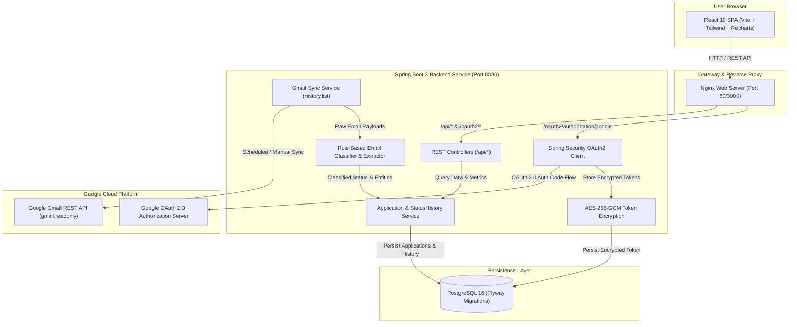

# Application Tracker

[](https://github.com/nayanhasnolyf/mail_tracker/actions/workflows/ci.yml)
[](https://openjdk.org/projects/jdk/21/)
[](https://spring.io/projects/spring-boot)
[](https://react.dev/)
[](https://tailwindcss.com/)
[](LICENSE)

**Application Tracker** is an intelligent, privacy-first job application tracking system designed as a production-grade monorepo. It connects securely with your personal Gmail via the official Google Cloud API, automatically classifies job confirmations, online assessments, interview invitations, offers, and rejection emails, and visualizes your job hunt on an interactive web dashboard.

---

## Table of Contents

- [Overview](#overview)
- [Key Features](#key-features)
- [Screenshots & UI Preview](#screenshots--ui-preview)
- [System Architecture](#system-architecture)
- [Tech Stack](#tech-stack)
- [Monorepo Directory Structure](#monorepo-directory-structure)
- [Quick Start & Setup Steps](#quick-start--setup-steps)
  - [Prerequisites](#prerequisites)
  - [Option A: Full-Stack Docker Compose (Recommended)](#option-a-full-stack-docker-compose-recommended)
  - [Option B: Local Development](#option-b-local-development)
- [Google Cloud OAuth 2.0 Setup](#google-cloud-oauth-20-setup)
- [Environment Variables](#environment-variables)
- [How Synchronization & Classification Work](#how-synchronization--classification-work)
  - [1. Gmail Synchronization Engine](#1-gmail-synchronization-engine)
  - [2. Intelligent Email Classifier & Entity Extractor](#2-intelligent-email-classifier--entity-extractor)
  - [3. Sensible Forward-Only Lifecycle Progression](#3-sensible-forward-only-lifecycle-progression)
- [Known Limitations](#known-limitations)
- [Future Work & Roadmap](#future-work--roadmap)
- [Testing & Quality Assurance](#testing--quality-assurance)
- [Security Guidelines](#security-guidelines)

---

## Overview

Applying for jobs across multiple job boards, corporate career portals, and staffing agencies scatters communications across hundreds of email threads. Manually logging application status updates in spreadsheets is tedious, error-prone, and frequently neglected.

**Application Tracker** automates this entire pipeline:
1. **Reads Gmail securely**: Requests only read-only mailbox permissions (`gmail.readonly`) without storing email contents.
2. **Classifies updates automatically**: Employs rule-based keyword and regular expression heuristics to detect whether an email is an initial application acknowledgment, online coding assessment, interview scheduling request, rejection, or formal offer letter.
3. **Organizes your pipeline**: Presents an intuitive Kanban board with drag-and-drop status adjustments, a searchable/filterable table, detailed chronological status transition timelines, automated stale follow-up warnings, and Recharts analytics.

---

## Key Features

- **Google OAuth 2.0 with Offline Access**: Secure authentication using Spring Security OAuth2 Client requesting offline refresh tokens encrypted at rest with AES-256-GCM.
- **Idempotent Gmail Synchronization**: Initial sync scans emails matching recruitment queries from the last 90 days; subsequent syncs use Gmail's `history.list` API for ultra-fast incremental synchronization.
- **Interactive Kanban Board**: Visual columns for `APPLIED`, `ASSESSMENT`, `INTERVIEW`, `OFFER`, and `REJECTED` with drag-and-drop state transitions, optimistic UI updates, and backend rollback on error.
- **Searchable & Filterable Table View**: Search applications across companies, roles, and personal notes; filter by stage; and sort by newest updates or company names.
- **Application Detail Drawer**: Slide-over drawer with editable personal notes (up to 5,000 characters), stage changer, and a vertical chronological status transition timeline.
- **Stale "Needs Follow-Up" Detector**: Identifies applications pending a response past customizable staleness thresholds (7, 14, or 30 days) with urgency indicators.
- **Visual Analytics with Recharts**: Applications submitted per week (area chart), hiring stage conversion funnel, status breakdown donut chart, and average days to first response metrics.
- **Self-Contained Interactive Demo**: Built-in mock mode allowing instant UI and workflow evaluation without requiring immediate Google OAuth credentials.

---

## Screenshots & UI Preview

> *Note: Place actual screenshots or screen recordings in `docs/screenshots/`.*

| Dashboard Kanban Board | Application Detail Drawer |
| :---: | :---: |
| ```[ Kanban Board Screenshot Placeholder ]``` <br> *Drag-and-drop columns with real-time status updates* | ```[ Detail Drawer Screenshot Placeholder ]``` <br> *Editable personal notes & status history timeline* |

| Recharts Analytics & Status Funnel | Needs Follow-Up Alert System |
| :---: | :---: |
| ```[ Analytics Page Screenshot Placeholder ]``` <br> *Applications per week, status funnel & response rate* | ```[ Follow-up Panel Screenshot Placeholder ]``` <br> *Stale application alerts with 7d / 14d / 30d filters* |

---

## System Architecture

The following diagram illustrates the interaction between the frontend client, reverse proxy, Spring Boot API services, database, and external Google Cloud APIs:



---

## Tech Stack

| Domain | Technology | Description |
| :--- | :--- | :--- |
| **Backend Runtime** | Java 21 | Long-term support release with virtual threads & modern records |
| **Backend Framework** | Spring Boot 3.3.4 | Spring Web, Spring Data JPA, Spring Security, Validation |
| **Security** | Spring Security OAuth2 Client | Google OAuth 2.0 login with offline refresh token support |
| **Cryptography** | AES-256-GCM | Encrypted token storage using Java Cryptography Architecture |
| **Database** | PostgreSQL 16 | Relational store with Flyway migration management |
| **Mail Client** | Google API Client | `google-api-services-gmail` (v1-rev20240520-2.0.0) |
| **Frontend Framework**| React 19 | Modern UI components with Hooks architecture |
| **Build Tooling** | Vite 8 | Fast ESM development server and Rollup production bundler |
| **Styling** | Tailwind CSS 3.4 | Modern dark-mode palette, glassmorphism & responsive layouts |
| **Data Visualization**| Recharts 3.10 | Responsive SVG charts (Area, Funnel progress, Donut charts) |
| **Iconography** | Lucide React | Consistent, scalable vector icons |
| **Testing (Backend)**| JUnit 5, Mockito, Testcontainers | Unit, MockMvc, and real PostgreSQL container integration tests |
| **Testing (Frontend)**| Vitest, React Testing Library, JSDOM | Fast component and user interaction testing |
| **Linting** | Oxlint | High-performance JavaScript/React linter |
| **DevOps & CI** | Docker, Docker Compose, GitHub Actions | Multi-stage container images and automated pull-request validation |

---

## Monorepo Directory Structure

```text
mail_tracker/
├── .github/
│   └── workflows/
│       └── ci.yml                   # GitHub Actions pipeline (backend, frontend test & lint)
├── backend/                         # Spring Boot 3 Java 21 backend service
│   ├── .mvn/wrapper/                # Maven wrapper files
│   ├── src/
│   │   ├── main/
│   │   │   ├── java/com/applicationtracker/
│   │   │   │   ├── config/          # Security, CORS, OpenAPI, and Async configuration
│   │   │   │   ├── controller/      # REST API endpoints (/api/applications, /api/stats, /api/sync)
│   │   │   │   ├── domain/          # JPA entities (User, Application, StatusHistory, SyncState)
│   │   │   │   ├── dto/             # API request/response DTOs & OpenAPI schemas
│   │   │   │   ├── repository/      # Spring Data JPA repositories
│   │   │   │   ├── service/         # GmailClient, EmailClassifier, ApplicationService, CryptoService
│   │   │   │   └── ApplicationTrackerApplication.java
│   │   │   └── resources/
│   │   │       ├── db/migration/    # Flyway database migration scripts (V1, V2)
│   │   │       └── application.yml  # Application properties & OAuth2 registration
│   │   └── test/                    # JUnit 5, Mockito, and Testcontainers test suites
│   ├── Dockerfile                   # Multi-stage Dockerfile (Eclipse Temurin JDK 21 -> JRE 21)
│   └── pom.xml                      # Maven project configuration
├── frontend/                        # React 19 + Vite dashboard
│   ├── public/                      # Static assets
│   ├── src/
│   │   ├── api/                     # Typed REST API client & demo mock datasets
│   │   ├── components/              # KanbanBoard, TableView, ApplicationDrawer, StatsView, etc.
│   │   ├── test/                    # Vitest and React Testing Library component tests
│   │   ├── types/                   # Status constants, color maps, and date formatters
│   │   ├── App.jsx                  # Main application state and view router
│   │   └── index.css                # Tailwind CSS entrypoint
│   ├── Dockerfile                   # Multi-stage Dockerfile (Node 22 -> Nginx Alpine)
│   ├── nginx.conf                   # Reverse proxy configuration for container deployment
│   ├── package.json                 # Node.js dependencies and scripts
│   ├── tailwind.config.js           # Tailwind design tokens
│   └── vite.config.js               # Vite config with proxy and Vitest environment
├── docs/
│   └── google-setup.md              # Detailed Google Cloud OAuth console setup guide
├── docker-compose.yml               # Multi-container orchestration (PostgreSQL, Backend, Frontend)
├── .env.example                     # Environment variable template
└── README.md                        # Project documentation
```

---

## Quick Start & Setup Steps

### Prerequisites

- **Docker & Docker Compose** (Recommended for full stack execution)
- **Java 21 JDK** (For local backend development)
- **Node.js 20+ & npm 10+** (For local frontend development)
- **Google Cloud Console Project** (For live Gmail synchronization)

### Option A: Full-Stack Docker Compose (Recommended)

1. **Clone the repository**:
   ```bash
   git clone https://github.com/nayanhasnolyf/mail_tracker.git
   cd mail_tracker
   ```

2. **Configure your environment**:
   ```bash
   cp .env.example .env
   ```
   *(Fill in your `GOOGLE_CLIENT_ID` and `GOOGLE_CLIENT_SECRET` if connecting live Gmail, or leave defaults to test with the built-in interactive demo mode).*

3. **Build and launch the full stack**:
   ```bash
   docker-compose up --build
   ```

4. **Access the application**:
   - **Frontend Web Dashboard**: [http://localhost:3000](http://localhost:3000)
   - **Backend API Health Check**: [http://localhost:8080/api/health](http://localhost:8080/api/health)
   - **Swagger / OpenAPI Documentation**: [http://localhost:8080/swagger-ui.html](http://localhost:8080/swagger-ui.html)
   - **PostgreSQL Database**: `localhost:5432` (database: `application_tracker`, user: `postgres`)

---

### Option B: Local Development

#### 1. Start the PostgreSQL Database
```bash
docker-compose up -d postgres
```

#### 2. Run the Backend API Service
```bash
cd backend
mvn spring-boot:run
```
*(On Windows PowerShell, use `.\mvnw.cmd spring-boot:run`)*

Verify the backend is operational:
```bash
curl http://localhost:8080/api/health
```

#### 3. Run the Frontend Development Server
In a separate terminal:
```bash
cd frontend
npm install
npm run dev
```
Open [http://localhost:5173](http://localhost:5173) in your browser.

---

## Google Cloud OAuth 2.0 Setup

To enable real Gmail reading and synchronization, set up an OAuth 2.0 client in the Google Cloud Console:

1. **Create Project**: Go to [Google Cloud Console](https://console.cloud.google.com/) and create a project named `application-tracker`.
2. **Enable Gmail API**: Navigate to **APIs & Services** &rarr; **Library**, search for **Gmail API**, and click **Enable**.
3. **Configure OAuth Consent Screen**:
   - Navigate to **APIs & Services** &rarr; **OAuth consent screen**.
   - User Type: **External**.
   - App Name: `Application Tracker`.
   - Scopes: Add `openid`, `email`, and `https://www.googleapis.com/auth/gmail.readonly`.
   - Test Users: Add your personal Gmail address under **Test users**.
4. **Create OAuth Client ID**:
   - Navigate to **APIs & Services** &rarr; **Credentials** &rarr; **Create Credentials** &rarr; **OAuth client ID**.
   - Application Type: **Web application**.
   - Name: `Application Tracker Local`.
   - **Authorized redirect URIs**:
     ```text
     http://localhost:8080/login/oauth2/code/google
     ```
5. **Copy Credentials**: Copy your **Client ID** and **Client Secret** into your `.env` file.

> [!TIP]
> For detailed screenshots, verification steps, and token lifecycle details, refer to the [Google Cloud Setup Guide](docs/google-setup.md).

---

## Environment Variables

All services consume environment variables configured in `.env`. A complete template is provided in `.env.example`:

| Variable | Description | Default Value | Required |
| :--- | :--- | :--- | :---: |
| `POSTGRES_DB` | PostgreSQL database name | `application_tracker` | Yes |
| `POSTGRES_USER` | PostgreSQL superuser | `postgres` | Yes |
| `POSTGRES_PASSWORD` | PostgreSQL password | `postgres` | Yes |
| `POSTGRES_PORT` | Host port mapped to PostgreSQL | `5432` | No |
| `SERVER_PORT` | Port for Spring Boot backend | `8080` | No |
| `SPRING_DATASOURCE_URL` | JDBC database connection string | `jdbc:postgresql://localhost:5432/application_tracker` | Yes |
| `APP_ENCRYPTION_KEY` | 32-byte hex/base64 key for AES-256-GCM token encryption | *Random 256-bit key* | Yes |
| `GOOGLE_CLIENT_ID` | OAuth 2.0 Web Client ID from Google Cloud Console | *None* | For live sync |
| `GOOGLE_CLIENT_SECRET` | OAuth 2.0 Client Secret from Google Cloud Console | *None* | For live sync |
| `GOOGLE_REDIRECT_URI` | Authorized OAuth redirect URI | `http://localhost:8080/login/oauth2/code/google` | Yes |
| `CORS_ALLOWED_ORIGIN` | Allowed origins for cross-origin browser requests | `http://localhost:3000,http://localhost:5173` | No |
| `OAUTH2_REDIRECT_URL` | Frontend URL redirected to after successful OAuth2 login | `http://localhost:3000` | No |
| `FRONTEND_PORT` | Port mapped to frontend container in Docker Compose | `3000` | No |

---

## How Synchronization & Classification Work

### 1. Gmail Synchronization Engine

Synchronization runs both automatically via `@Scheduled` cron jobs (every 15 minutes) and on-demand via `POST /api/sync`:

```
┌─────────────────────────────────────────────────────────────────┐
│                     GMAIL SYNC WORKFLOW                         │
└─────────────────────────────────────────────────────────────────┘
                               │
                 Check stored sync_state for user
                               │
                ┌──────────────┴──────────────┐
                ▼                             ▼
        [First-Time Sync]            [Subsequent Syncs]
  Query messages newer than 90d       Call users.history.list
  matching recruitment keywords       using stored historyId
                │                             │
                └──────────────┬──────────────┘
                               ▼
               Fetch message metadata & plain-text body
                               ▼
               Check idempotency (source_email_id)
                               ▼
               Pass to ClassifierService & Extractor
                               ▼
               Save new Application & StatusHistory
                               ▼
               Update sync_state (new historyId)
```

- **Initial Sync**: Queries messages with `subject:(application OR interview OR assessment OR regret OR offer)` received within the past 90 days.
- **Incremental Sync**: Stores the latest `historyId` in the `sync_state` table. Subsequent runs call `history.list(startHistoryId)`, retrieving only newly arrived message IDs with minimal API quota consumption.
- **Idempotency Guarantee**: Unique database constraints on `(user_id, source_email_id)` ensure the same email message is never processed more than once.

### 2. Intelligent Email Classifier & Entity Extractor

Emails are processed through the `EmailClassifier` component:
- **Status Classification**: Evaluates email subjects and bodies against tailored regex and keyword patterns matching recruitment communication stages:
  - `APPLIED`: "Thank you for applying", "Application received", "We have received your application".
  - `ASSESSMENT`: "HackerRank", "Codility", "take-home challenge", "online assessment", "codesignal".
  - `INTERVIEW`: "invitation to interview", "schedule a phone screen", "round of interviews", "meet the team".
  - `OFFER`: "offer of employment", "pleased to offer you", "formal offer letter".
  - `REJECTED`: "decided to move forward with other candidates", "not selected at this time", "unfortunately".
- **Company Extraction**:
  - Analyzes the sender domain (filtering out generic ESPs like `greenhouse.io`, `lever.co`, `workday.com`, `ashbyhq.com`, `gmail.com`).
  - Evaluates the sender display name (e.g. `"Stripe Recruiting"` &rarr; `"Stripe"`).
  - Inspects common subject patterns (`"Your application to Stripe"` &rarr; `"Stripe"`).
- **Role Extraction**:
  - Extracts target job titles from subject lines (e.g. `"Application for Senior Software Engineer"` &rarr; `"Senior Software Engineer"`).
  - Searches body text for position patterns (`"role of Backend Developer"` &rarr; `"Backend Developer"`).

### 3. Sensible Forward-Only Lifecycle Progression

To prevent out-of-order emails or generic automated newsletters from corrupting valid pipeline states:
- Applications only progress forward in the lifecycle:
  $$\text{APPLIED} \longrightarrow \text{ASSESSMENT} \longrightarrow \text{INTERVIEW} \longrightarrow \text{OFFER} \text{ or } \text{REJECTED}$$
- An application in `INTERVIEW` status will never revert back to `APPLIED` if an automated confirmation email arrives late.

---

## Known Limitations

### 1. ⚠️ Google OAuth "Testing" Mode Refresh Token Expiry
- When a Google Cloud project's OAuth Consent Screen is in **"Testing"** publishing status, **Google enforces that refresh tokens expire after exactly 7 days**.
- When an expired token is refreshed, Google returns an `invalid_grant` error.
- **How Application Tracker handles this**: The backend catches `invalid_grant`, sets `reauth_required = true` on the user, and returns an `HTTP 401 Reauth Required` response. The frontend displays a re-authentication banner directing the user to `/oauth2/authorization/google` to renew credentials.
- **Production Solution**: Transitioning the project to **"In production"** in Google Cloud Console issues persistent refresh tokens (which may require Google verification for the sensitive `gmail.readonly` scope).

### 2. Rule-Based Classification Accuracy Edge Cases
- Rule-based regex and keyword heuristics achieve $>95\%$ accuracy on standard ATS communications (Greenhouse, Lever, Workday, Ashby, BambooHR).
- Edge cases may occur with:
  - Highly unconventional recruiter emails lacking standard terminology.
  - Multi-threaded emails containing forwarded historical messages from earlier interview rounds.
  - Senders using complex third-party agency subdomains.
- **Mitigation**: Users can manually reclassify any application or adjust company/role names directly from the Application Detail Drawer at any time.

---

## Future Work & Roadmap

- [ ] **AI / LLM Classification Engine**: Introduce an LLM-based classifier implementation (OpenAI, Anthropic Claude, or local Ollama) behind the existing `EmailClassifier` interface for zero-shot natural language understanding, complex thread summarization, and salary expectation extraction.
- [ ] **Google Cloud Pub/Sub Push Webhooks**: Replace 15-minute polling with real-time push notifications using Gmail `users.watch` and Google Cloud Pub/Sub.
- [ ] **Automated Recruiter Follow-Up Drafts**: One-click generation of professional follow-up email drafts based on days in `APPLIED` without response.
- [ ] **Google Calendar Sync**: Automatic detection and calendar event creation for scheduled interview invites.
- [ ] **Multi-Mailbox Support**: Aggregate job applications across multiple personal and professional email accounts.

---

## Testing & Quality Assurance

Both backend and frontend maintain extensive automated test coverage:

### Backend Test Suite (Java 21)
```bash
cd backend
mvn clean test
```
- **Unit Tests**: Mockito tests covering `ApplicationService`, `ClassifierService`, `GmailClient`, and token encryption.
- **Controller Tests**: MockMvc integration tests verifying authorization, bean validation, and pagination.
- **Repository Tests**: Real PostgreSQL container integration tests powered by **Testcontainers**.

### Frontend Test Suite (React 19 & Vitest)
```bash
cd frontend

# Run unit and component tests with Vitest & React Testing Library
npm test

# Run fast code linting with Oxlint
npm run lint

# Validate production bundle compilation
npm run build
```

---

## Security Guidelines

- **Never Commit Secrets**: Never commit `.env`, `credentials*.json`, `token*.json`, or encryption secret keys.
- **Minimal Required Scopes**: Strictly request `https://www.googleapis.com/auth/gmail.readonly`. Never request full mailbox write or send permissions.
- **Encryption at Rest**: Google OAuth refresh tokens are encrypted at rest using AES-256 in Galois/Counter Mode (GCM) with an initialization vector before being stored in the database.
- **Container Isolation**: Docker images run as unprivileged non-root users (`appuser`).

---

## License

Distributed under the MIT License. See [LICENSE](LICENSE) for more details.